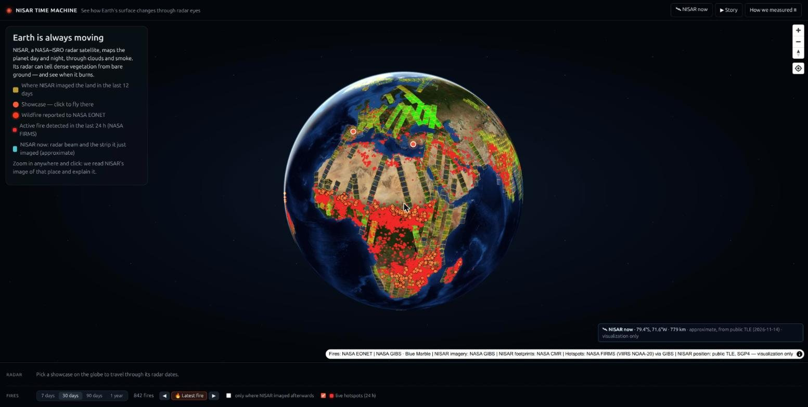
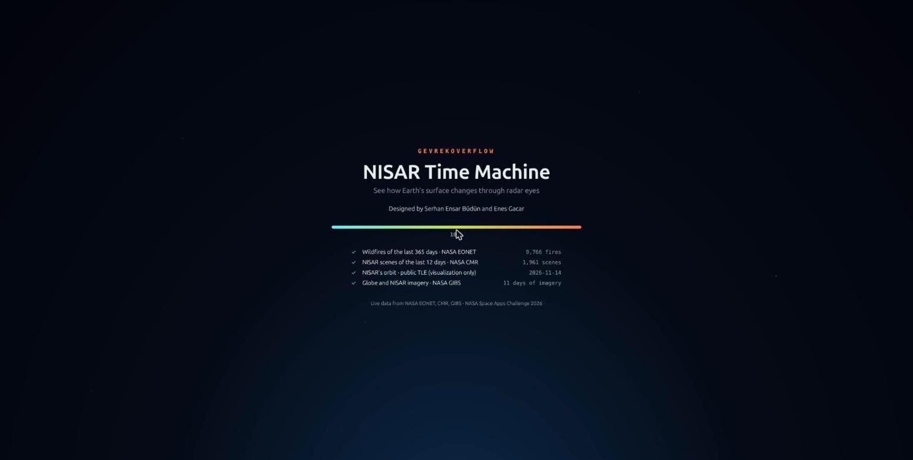
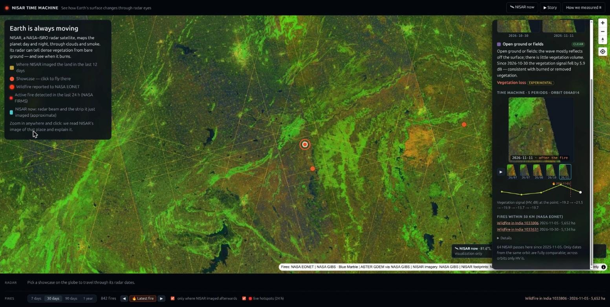
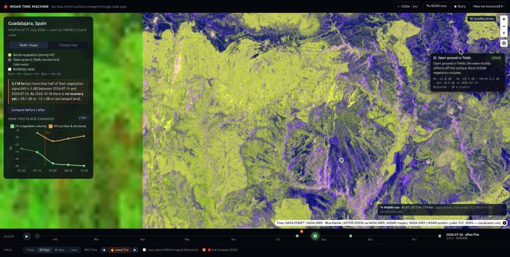
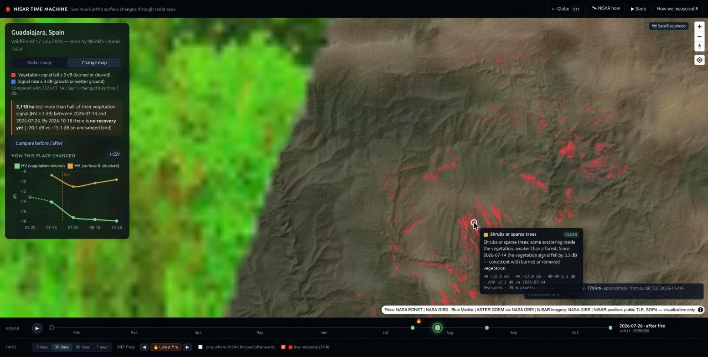
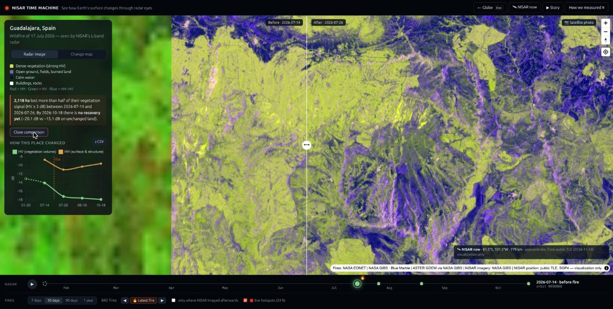
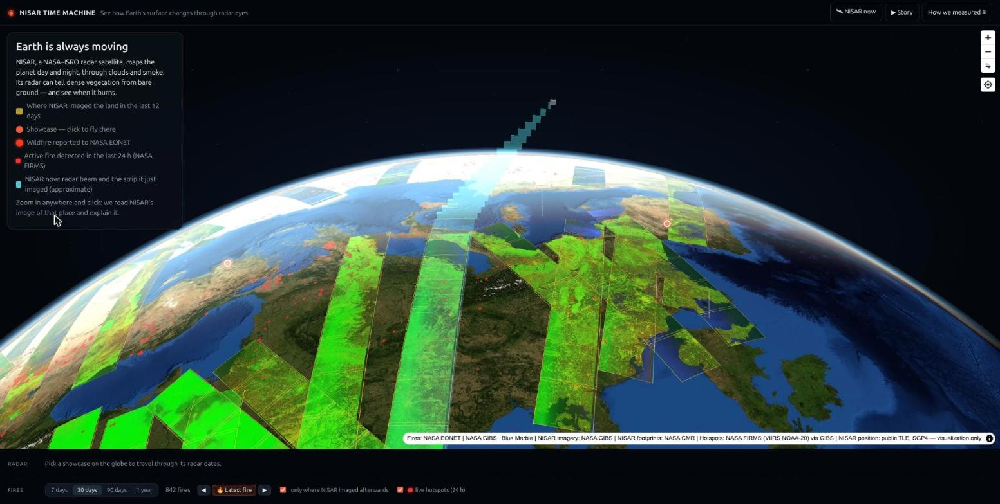
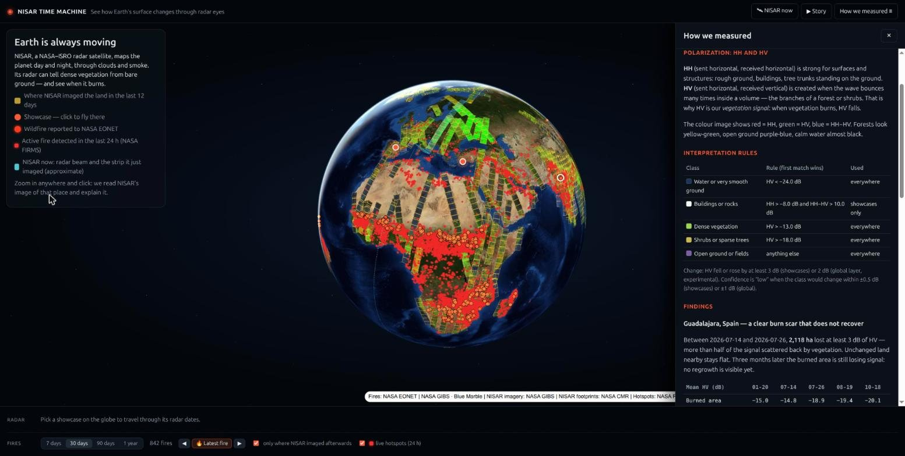
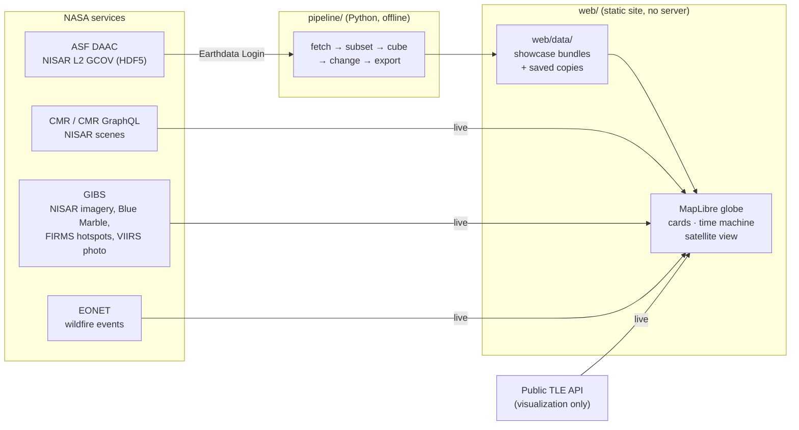

<div align="center">

# 🛰️ NISAR Time Machine

**See how Earth's surface changes through radar eyes.**

An open-source web app that turns NASA–ISRO **NISAR** L-band radar data into something anyone can explore:
where the land changed, what it is now, and *why* the radar sees it that way.

**Team GevrekOverFlow** · NASA Space Apps Challenge 2026 ·
Challenge: [Dancing with the SARs](https://www.spaceappschallenge.org/2026/challenges/dancing-with-the-sars/)



</div>

---

## Contents

- [Why](#why)
- [What you can do](#what-you-can-do)
- [How it works](#how-it-works)
- [What we found](#what-we-found)
- [Polarization: HH and HV](#polarization-hh-and-hv)
- [Architecture](#architecture)
- [NASA data](#nasa-data)
- [Run it](#run-it)
- [Repository layout](#repository-layout)
- [Limitations](#limitations)
- [Team and use of AI](#team-and-use-of-ai)
- [License](#license)

## Why

Earth's surface never stops changing: forests burn and grow back, fields are ploughed and harvested, rivers
flood. **NISAR** — launched by NASA and ISRO in 2025 — measures these changes with its own microwave pulses,
day and night, through clouds and smoke. Its data, however, comes as gigabyte-sized HDF5 files of
backscatter values in decibels: unreadable for anyone who is not a radar scientist.

NISAR Time Machine bridges that gap. It answers three questions for any place on Earth, in plain language:

1. **Has the surface changed?** — before/after images and a change map.
2. **What is it now?** — dense vegetation, shrubs, open ground, water, buildings.
3. **Why does the radar see it that way?** — each answer is explained with the physics of HH and HV
   polarization, with the numbers one click away.

## What you can do

### Start with live NASA data

The site opens with a cover screen while it loads everything **live** from NASA: one year of wildfires (EONET),
the NISAR scenes of the last 12 days (CMR), NISAR's orbit and the radar imagery itself (GIBS). If a service is
down, a saved copy in this repository takes over and the cover says so.



### Explore the globe

- **NISAR imagery of the last 12 days** on a 3D globe (red = HH, green = HV, blue = HH−HV).
- **Wildfires of the last year** from NASA EONET, filterable by 7 days / 30 days / 90 days / 1 year.
- **Live hotspots** of the last 24 hours from NASA FIRMS (VIIRS NOAA-20).
- **🔥 Latest fire** jumps to the newest wildfire; ◀ ▶ step back through older ones. With *only where NISAR
  imaged afterwards*, it skips fires that the radar has not seen since.
- **Click a legend item** to hide or show its layer (e.g. the bright radar strips); the choice is remembered.
- **Locate me** flies to your position (it never leaves your device). Close up, the map switches to Blue
  Marble colours with terrain, and a **📷 satellite photo** (VIIRS, day by day) can be shown on top.

### Click anywhere: what NISAR saw there

Clicking any place opens a card that asks NASA's catalogue when NISAR imaged it, reads the radar image of
those dates and explains it:

- the land class and how sure we are (*clear* / *uncertain*),
- the change between any two dates (*experimental*),
- **a time machine**: up to six NISAR images spread over the whole record, all from the same orbit so they are
  comparable, played as an animation with the vegetation signal of each image and the fire date marked,
- nearby wildfires and the raw numbers (dB, formula) under *Details*.



> **Example — Wildfire in India (5 Nov 2026).** Between the passes of 30 Oct and 11 Nov (same orbit), the
> vegetation signal at the fire fell by **5.9 dB**: the site confirms a NASA-reported fire in NISAR data on its
> own.

### Showcases: full-resolution analysis

Two wildfires were processed from the original NISAR GCOV files at **20 m** resolution:

| | |
|:--:|:--:|
|  |  |
| **Radar image** with a legend and a timeline of comparable dates | **Change map**: red where the vegetation signal fell ≥ 3 dB |

- **Timeline** of every date, with a real time axis and the fire marked. Dates from another orbit are shown
  as *HV only* (see [Polarization](#polarization-hh-and-hv)).
- **Click a point** to get its HH and HV time series; **⤓ CSV** downloads it.
- **Compare before / after** with a slider.



### Ride with the satellite

**🛰 NISAR now** shows NISAR's approximate position, computed every second from its public orbital elements,
with the radar beam drawn from the published geometry: it looks to the **left** at 33–47° incidence and images a
~242 km wide strip. *Satellite view* follows NISAR from its own eye — one camera frame per second, like a fixed
game tick, so it stays light — and *Outside view* shows the beam from the side.
This is **a visualization only**: it is not used in any measurement.



<sub>Beam shown at a computed future pass over Europe, for illustration.</sub>

### Understand the method

**How we measured ≡** opens a drawer with the radar basics, the interpretation rules (generated from the same
`rules.json` the app uses, so text and code never drift apart), our findings and every data source.



## How it works

### 1. Only comparable dates

A radar image depends on the viewing geometry. NISAR revisits each place every **12 days** from the same orbit,
but also sees it from other orbits. Every NISAR file name carries its track, direction and frame
(e.g. `095D068`); the timeline and the time machine use **one geometry at a time**, so a change is a change of
the ground, not of the viewing angle.

### 2. Transparent rules instead of a black box

The land class comes from a short, readable rule list in [`web/rules.json`](web/rules.json)
(first match wins):

| Class | Rule |
|---|---|
| Water or very smooth ground | HV < −24 dB |
| Buildings or rocks *(showcases only)* | HH > −8 dB and HH − HV > 10 dB |
| Dense vegetation | HV > −13 dB |
| Shrubs or sparse trees | HV > −18 dB |
| Open ground or fields | anything else |

**Change** = HV fell or rose by at least 3 dB (showcases) or 2 dB (global layer, experimental). The confidence
is *uncertain* when a small error (±0.5 dB showcases, ±1 dB global) would change the answer.

### 3. Anywhere on Earth from map tiles

Outside the showcases the app reads NASA GIBS NISAR imagery (zoom 8, ~500 m) and converts the colours back to
decibels with a model we fitted on full-resolution data:

```
HV ≈ −61.02 + 9.329·ln(1 + G) + 0.071·ln(1 + R)
HH ≈ −50.07 + 7.047·ln(1 + G) + 1.436·ln(1 + R)      (R, G = pixel colour, 0–255)
```

Checked on another date and on a second region: HV within about **±1 dB**, vegetation classes **85 %** in
agreement with full resolution, and the change test finds **96 %** of the Spanish burn scar with **0.7 %** false
alarms on unchanged land.

Some NISAR passes record **HH only** (single polarization). The app reads the polarization mode from the file
name and never uses those passes for vegetation or change.

## What we found

### Guadalajara, Spain — a burn scar that does not recover

Wildfire of 17 July 2026. Between 14 and 26 July, **2,118 ha** lost at least 3 dB of HV — more than half of the
signal scattered back by vegetation — while unchanged land nearby stayed flat:

| Mean HV (dB) | 20 Jan* | 14 Jul | 26 Jul | 19 Aug | 18 Oct |
|---|---:|---:|---:|---:|---:|
| Burned area | −15.0 | −14.8 | **−18.9** | −19.4 | −20.1 |
| Unchanged area | −15.5 | −15.2 | −15.0 | −15.3 | −15.1 |

<sub>* another orbit, HV only.</sub>

Three months later the burned area is still losing signal: **no regrowth yet**. The January image tells us that
summer drying did not lower HV before the fire — the drop is the fire.

### Muğla – Fethiye, Türkiye — the radar barely noticed (hypothesis)

Wildfire of 28 July 2026. The scar is clear in optical images and in NASA fire detections, yet only **~9 ha**
lost 3 dB of HV. Our hypothesis: L-band waves are ~24 cm long and interact mostly with **trunks and large
branches**, not leaves and needles. If the fire burned the understory and crowns but left charred trunks
standing, the trunks keep scattering and the radar sees little change. Steep terrain and soil moisture after the
fire can also mask the signal. Testing this needs field data or a shorter wavelength (e.g. C-band).

## Polarization: HH and HV

- **HH** (sent horizontal, received horizontal) is strong for **surfaces and structures**: rough ground,
  buildings, tree trunks standing on the ground (double bounce).
- **HV** (sent horizontal, received vertical) only appears when the wave bounces many times inside a
  **volume** — the branches of a forest or shrubs. That is why HV is our *vegetation signal*: when vegetation
  burns, HV falls.
- Across different orbits, HV of unchanged land agrees well (**r = 0.90**, mean difference 0.3 dB) while HH does
  not (r = 0.76, −2.3 dB): volume scattering depends little on the viewing angle, surface scattering does. So
  dates from other orbits are compared with **HV only**.

## Architecture



- **Web:** plain ES modules, no build step. [MapLibre GL](https://maplibre.org/) (globe), Chart.js (time series),
  satellite.js (SGP4 orbit propagation). Everything runs in the browser; nothing about the user is sent anywhere.
- **Pipeline:** crops NISAR GCOV files to a region, groups them by orbit geometry, applies a speckle filter and
  writes compact web bundles (8-bit dB frames, a binary time cube and a manifest with the region summary).

## NASA data

| Data | Used for | How |
|---|---|---|
| **NISAR L2 GCOV** (NASA–ISRO, ASF DAAC) | Showcases at 20 m | Pipeline, Earthdata Login |
| **NASA CMR** | Pass dates of any place, footprints of the last 12 days, polarization mode | Live (CMR + CMR GraphQL) |
| **NASA GIBS** — NISAR GCOV layer | Global imagery, values anywhere, time machine | Live |
| **NASA GIBS** — Blue Marble, ASTER GDEM relief | Base map | Live |
| **NASA FIRMS** — VIIRS NOAA-20 375 m | Active fire hotspots, last 24 h | Live (GIBS WMS) |
| **NASA GIBS** — VIIRS NOAA-20 true colour | Optional satellite photo | Live |
| **NASA EONET** | Wildfire events of the last year | Live (~7 MB) |
| Public TLE API (listed on api.nasa.gov), NORAD 65053 | NISAR's position — **visualization only** | Live |

Saved copies in [`web/data/global/`](web/data/global) are used only if a live service fails.

## Run it

The site is static. Serve the `web/` folder with any web server:

```bash
cd web
python3 -m http.server 8765
# open http://127.0.0.1:8765
```

Browser tests: open <http://127.0.0.1:8765/tests.html> (56 tests).

### Pipeline (only to rebuild the showcases)

```bash
python -m venv .venv && source .venv/bin/activate
pip install asf_search rasterio h5py pyproj numpy shapely pillow requests pytest

python pipeline/fetch.py --region spain --list                               # no login needed
python pipeline/fetch.py --region spain --group 095D068 --download --limit 2  # needs Earthdata Login
python pipeline/subset.py --region spain --group 095D068 --delete-raw
python pipeline/run_region.py --region spain --group 095D068                 # → web/data/spain/

LC_ALL=C.UTF-8 pytest tests                                                  # 38 tests
```

Downloading needs a free [NASA Earthdata Login](https://urs.earthdata.nasa.gov), read from the
`EARTHDATA_USERNAME` / `EARTHDATA_PASSWORD` environment variables or `~/.netrc`. Credentials are never stored in
this repository. On systems with a Turkish locale set `LC_ALL=C.UTF-8` (GDAL compares option names
case-insensitively).

Refresh the saved fallback copies:

```bash
python pipeline/eonet.py --days 365      # web/data/global/fires.json
python pipeline/passes.py --days 12      # web/data/global/passes.geojson
```

## Repository layout

```
web/                    static site (GitHub Pages)
  index.html, style.css
  rules.json            interpretation rules (also rendered in "How we measured")
  story.json            guided story
  js/
    app.js              wiring: globe, panels, strip, cover
    live.js             live loaders (EONET, CMR GraphQL) with saved fallbacks
    map.js              MapLibre layers: imagery, fires, FIRMS, satellite
    globalcard.js       "what NISAR saw here" card
    timemachine.js      periods of one place, animated
    gibs.js, rules.js   read GIBS colours → dB → class
    cmr.js              pass dates, orbit geometry, polarization mode
    orbit.js, satview.js  NISAR position (SGP4) and satellite view
    timeline.js, chart.js, compare.js, method.js, story.js, cover.js
  data/                 showcase bundles (spain, mugla) and saved copies (global)
  tests.html            browser tests
pipeline/               Python: fetch, subset, cube, speckle, change, export, passes, eonet
tests/                  pytest
docs/                   research, design, screenshots
```

## Limitations

- NISAR data from 2026 are partly **provisional** (still being validated by the mission).
- Only dates from the **same orbit** are fully comparable; across orbits only HV is.
- The global layer works from ~500 m map tiles: good for classes and large changes, not for exact borders.
- Steep slopes facing away from the radar can be in shadow; soil moisture changes HH.
- The rules are simple and transparent, **not an official land-cover classification**.
- *NISAR now* is an approximate position from public orbital elements; the beam is drawn from published geometry
  and does not show whether the radar is switched on. It is a visualization only.
- The optional satellite photo may be cloudy; step back a few days to find a clear one.

## Team and use of AI

**GevrekOverFlow** — designed by **Serhan Ensar Büdün** and **Enes Gacar**.

The project idea, the problem definition and all design decisions were made by the team. AI tools were used as
support for technical code and writing.

Research notes (in Turkish): [problem evidence](docs/01-why-kanit.md) ·
[existing tools and gaps](docs/03-mevcut-araclar.md) · design:
[v1](docs/specs/2026-11-14-nisar-zaman-makinesi-design.md), [v2](docs/specs/2026-11-14-v2-ek-tasarim.md)

## License

Code: [MIT](LICENSE). NASA data and imagery are provided by NASA and its partners and follow their own terms
(NASA data are generally free of restrictions); please credit the sources listed above.
